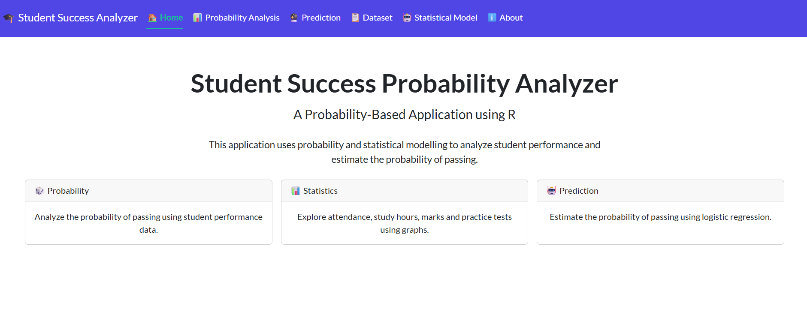
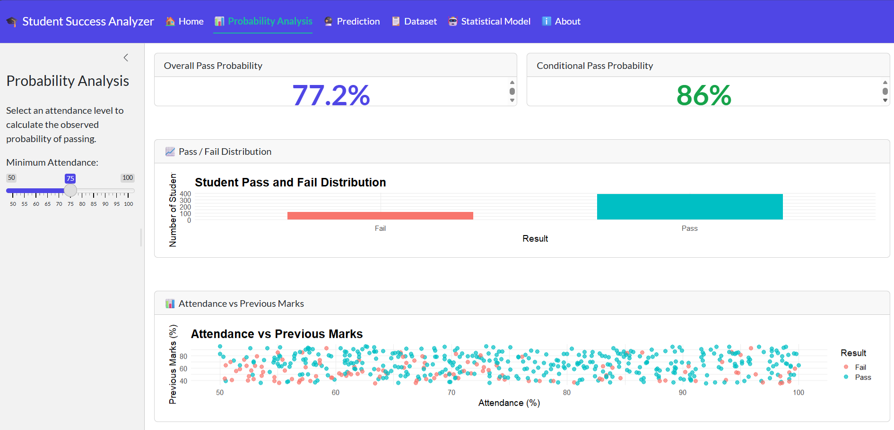
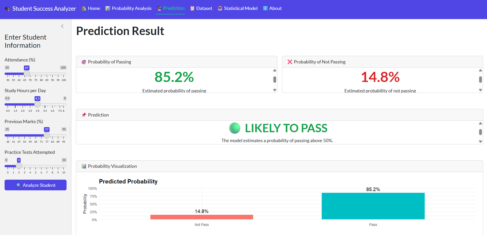
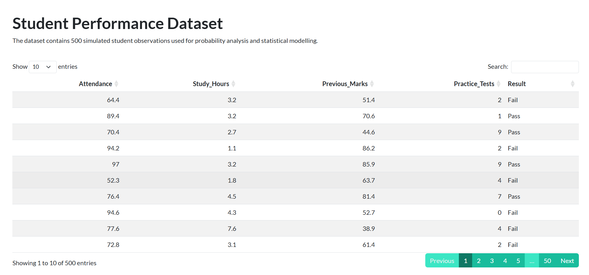
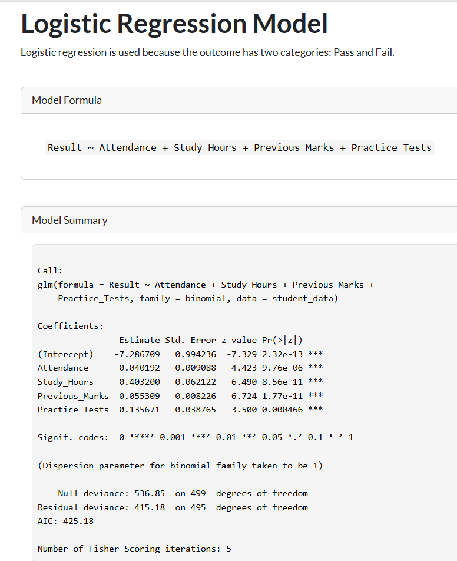
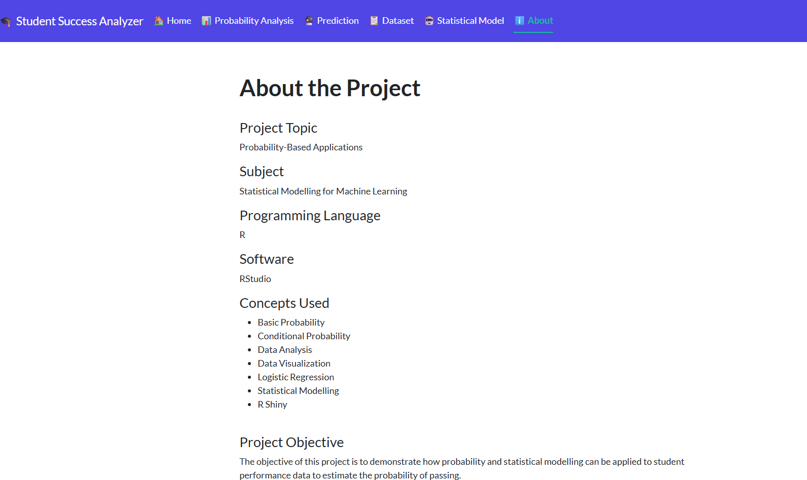

Student Success Probability Analyzer

An interactive R Shiny application that estimates student success probability using statistical analysis, a logistic probability function, and academic performance data.

Project Overview

The Student Success Probability Analyzer is an interactive application developed using R and Shiny. It demonstrates how academic factors can be used to estimate the probability of a student passing an examination.

The application allows users to explore how attendance, study hours, previous marks, and practice tests relate to student success probability.

Features

- Interactive student performance analysis
- Probability-based pass/fail estimation
- Academic performance input parameters
- Statistical calculations
- Interactive data visualizations
- User-friendly dashboard

Technologies Used

- R Programming
- R Shiny
- bslib
- ggplot2
- dplyr
- DT

Methodology

The application uses a logistic probability function to estimate the probability of student success.

The factors considered include:

- Attendance
- Study Hours
- Previous Marks
- Practice Tests

The application uses a predefined probability formula to demonstrate how these factors contribute to an estimated pass probability.

Note: The current implementation uses predefined coefficients and randomly generated sample data. It is a probability-based demonstration of concepts related to statistical modeling and machine learning, rather than a model trained on a real-world student dataset.

Dataset

The application generates a sample dataset of 500 students using R's random data generation functions.

The dataset includes academic performance factors used for probability calculations and visualization.

How to Run the Project

1. Install R and RStudio.
2. Install the required packages:

install.packages(c("shiny", "bslib", "ggplot2", "dplyr", "DT"))

3. Open the "app.R" file in RStudio.
4. Run the application using:

shiny::runApp()

Learning Outcomes

Through this project, I explored:

- Probability and statistical analysis
- Logistic probability functions
- Data visualization using ggplot2
- Interactive dashboard development using R Shiny
- Application of statistical concepts to an academic use case

Author

Developed as an academic project using R Programming and R Shiny.

## Project Screenshots

### Home Dashboard

### Probability Analysis

### Student Prediction Results

### Dataset

### Statistical Model Formula

### About the Project

